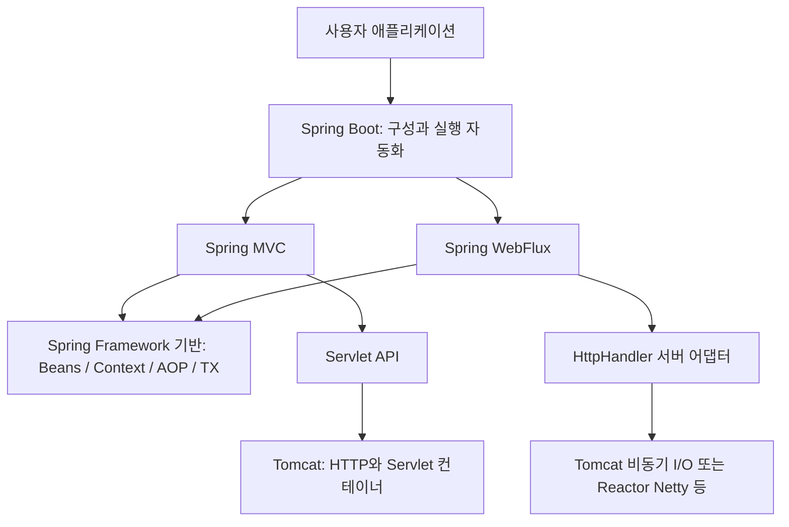

# Spring 생태계와 기술 관계

조사일: 2026-11-06. 동작 연구 기준은 Framework v6.2.1·Boot v3.4.1이다. 소스의 클래스·메서드 대응은 [소스 지도](../reference/03-learning-stage-mapping.md), 구현 추천은 [로드맵](03-implementation-roadmap.md)을 참고한다.

이 문서는 기술 관계를 찾는 참고 자료이며 학습 순서를 정하지 않는다. 현재 과정은 같은 HTTP 주문 앱의 문제를 해결하는 00~19 순서다. prototype·full configuration·트랜잭션·View·reactive는 [확장 과정](05-extension-tracks.md)의 출발 문제에서 선택한다.

## 1. 서로 다른 종류의 이름이다

Spring이라는 말은 Spring Framework를 가리키기도 하고 그 위에 구축된 프로젝트 전체를 가리키기도 한다. MVC와 WebFlux는 Framework 안의 웹 프레임워크다. Boot는 Framework를 이용하는 애플리케이션의 구성·실행을 편하게 만드는 별도 프로젝트다. 동등한 위치의 변종이나 교체 제품 목록으로 외우면 역할을 혼동하기 쉽다. [Framework 공식 개요](https://docs.spring.io/spring-framework/reference/6.2/overview.html)

| 이름 | 위치와 책임 | 이번 학습에서의 의미 |
|---|---|---|
| Spring | Framework 또는 전체 생태계를 뜻하는 문맥 의존 용어 | 문서에서는 구체적인 프로젝트명을 함께 적음 |
| Spring Framework | IoC/DI, context, AOP, 트랜잭션, 웹 등 기반 기능 | 직접 만들 핵심 대상 |
| Spring Core / Beans / Context | Framework의 기반 모듈. core는 리소스·타입·유틸리티 등을 제공하고 beans/context가 컨테이너를 구성 | Map에 객체를 담는 것부터 refresh까지 단계적으로 확장 |
| Spring AOP / Spring TX / JDBC | 횡단 관심사, 트랜잭션 경계, JDBC 자원 접근 | 프록시 적용 시점과 연결 공유 학습 |
| Spring Web (`spring-web`) | 공통 HTTP·웹 기반 추상화·Servlet/Reactive 어댑터 등 | MVC와 같은 말이 아님 |
| Spring MVC (`spring-webmvc`) | Servlet 기반 웹 요청 처리. 중심은 DispatcherServlet | 자체 Servlet 계약 위에서 동기 처리부터 재현 |
| Spring WebFlux (`spring-webflux`) | reactive 웹 처리. 중심은 DispatcherHandler, HTTP 경계는 HttpHandler | 서버 비동기·논블로킹 I/O가 필요한 후속 과정 |
| Spring Boot | 실행 진입점, 자동 구성, 외부 설정, 의존성 관리·starter, 내장 서버 연동, 운영 기능 | 코어와 MVC의 조립을 이해한 뒤 자동화 |
| Apache Tomcat | Spring과 별도인 HTTP 서버·Servlet 컨테이너 | 직접 만든 simple-tomcat이 이 계층을 담당 |

Framework의 범위와 모듈 관계는 [공식 개요](https://docs.spring.io/spring-framework/reference/6.2/overview.html), Boot의 기능 범위는 [공식 프로젝트 소개](https://spring.io/projects/spring-boot/)를 기준으로 정리했다. 세부 내부 구현은 각 태그의 소스 지도에서 확인한다.



그림은 책임 관계다. Boot 없이 Framework·MVC·WebFlux를 사용할 수 있고, 웹 서버 없이 IoC·AOP만 사용하는 프로그램도 가능하다.

## 2. MVC와 WebFlux의 차이

| 관점 | Spring MVC | Spring WebFlux |
|---|---|---|
| 요청 경계 | Servlet request/response | ServerWebExchange, ServerHttpRequest/Response |
| 조정자 | DispatcherServlet | DispatcherHandler |
| 호출 모델 | 보통 요청 처리 스레드에서 호출·반환, 비동기 확장도 지원 | Publisher 기반의 비동기 처리·결과 연결 |
| 확장 지점 | HandlerMapping, HandlerAdapter, argument resolver, return value handler, exception resolver | HandlerMapping, HandlerAdapter, HandlerResultHandler, WebFilter 등 |
| 서버 | Servlet 컨테이너 | Reactor Netty 또는 적합한 Servlet 비동기·논블로킹 서버 등 |
| 데이터 접근 | JDBC 같은 blocking API를 자연스럽게 사용 | 끝까지 논블로킹을 유지하려면 R2DBC 등 적절한 접근 필요 |
| 이 프로젝트의 출발점 | 동기 Servlet MVC | 현재 서버로는 선행 조건 부족 |

`@RestController`를 쓴다는 사실이나 `Mono`를 반환한다는 사실만으로 WebFlux라고 판단할 수 없다. MVC도 reactive 반환형을 지원한다. 반대로 WebFlux가 JDBC 호출 자체를 논블로킹으로 바꿔 주지는 않는다. 다른 실행기에 blocking 작업을 옮겨도 해당 작업의 blocking 성질은 남는다. [WebFlux 공식 비교](https://docs.spring.io/spring-framework/reference/6.2/web/webflux/new-framework.html)

Tomcat에서 WebFlux를 실행하는 것도 가능하다. v6.2.1의 ServletHttpHandlerAdapter는 `startAsync()`를 사용하고, ServletServerHttpRequest/Response가 ReadListener/WriteListener를 연결한다. 따라서 “Tomcat이면 MVC만 가능”, “MVC의 확장판이 WebFlux”라는 설명은 부정확하다. [실제 어댑터 소스](https://github.com/spring-projects/spring-framework/blob/v6.2.1/spring-web/src/main/java/org/springframework/http/server/reactive/ServletHttpHandlerAdapter.java)

## 3. Boot가 자동화하는 것

Boot를 `main()`에서 서버를 시작하는 래퍼로만 만들면 핵심을 상당 부분 놓친다.

- `SpringApplication.run`: Environment 준비, Context 생성·준비·refresh, runner 실행, 실패 처리.
- 내장 서버: WebServerFactory 선택, Servlet 등록, refresh 중 서버 준비, lifecycle에서 요청 수락 시작, 종료 조정.
- 자동 구성: 사용자 설정을 반영한 뒤 classpath·property·bean 조건으로 기본 빈 정의를 추가하고, 사용자 빈이 있으면 물러남.
- starter/BOM: 라이브러리 묶음과 버전 정합성. 런타임 기능과 빌드 메타데이터를 구분함.
- 외부 설정·운영: 속성 바인딩, health·metrics 등. 이번 첫 완주에서 모두 구현할 필요는 없음.

Boot v3.4.1은 AutoConfiguration.imports 후보 로딩을 사용한다. 오래된 튜토리얼의 자동 구성 후보용 `spring.factories` 설명을 그대로 옮기지 않는다. `spring.factories` 자체가 Boot의 모든 용도에서 사라졌다는 뜻도 아니다. [AutoConfigurationImportSelector 소스](https://github.com/spring-projects/spring-boot/blob/v3.4.1/spring-boot-project/spring-boot-autoconfigure/src/main/java/org/springframework/boot/autoconfigure/AutoConfigurationImportSelector.java)

## 4. 함께 자주 나오는 프로젝트

아래는 역할 조사이며 이들 프로젝트의 내부 소스·버전별 계약까지 검증한 것은 아니다. 실제 재구현은 별도 계획이 필요하다.

| 기술 | 무엇을 해결하는가 | 학습 대상에 연결되는 지점 | 이번 범위 |
|---|---|---|---|
| [Spring Security](https://spring.io/projects/spring-security/) | 인증·인가와 보안 기능 | 웹 필터·서비스 호출 경계 | 역할 설명, 후속 선택 |
| [Spring Data](https://spring.io/projects/spring-data/) | 저장소별 Repository·데이터 접근 프로그래밍 모델 | DI, Repository 프록시, 트랜잭션 | 역할 설명; simple-jorm과 통합은 별도 |
| JPA / Hibernate | JPA는 영속성 표준, Hibernate는 그 구현체 중 하나 | 데이터 접근·영속성 컨텍스트 | Spring 자체와 구분; simple-jorm 문서 참고 |
| [Spring Cloud](https://spring.io/projects/spring-cloud/) | 설정 관리·서비스 발견·라우팅 등 분산 시스템 패턴 | Boot 기반 서비스의 외부 인프라 | 첫 완주 제외 |
| [Spring Batch](https://spring.io/projects/spring-batch/) | 대량 작업·재시작·청크 기반 처리 | 트랜잭션·작업 수명 | 첫 완주 제외 |
| [Project Reactor](https://projectreactor.io/docs/core/release/reference/gettingStarted.html) | Mono·Flux로 표현하는 reactive 라이브러리 | WebFlux의 실행·데이터 흐름 | 후속 reactive 과정에서 조사 |
| Actuator | Boot 애플리케이션 운영 관찰 기능 | Context·서버·health·metrics | health 단일 실험도 별도 과제 |

Spring Data JPA와 ORM, Spring Security와 MVC interceptor, Boot starter와 자동 구성은 각각 다른 책임이다. 기능의 개입 위치를 구분하는 것이 전체 생태계를 재구현하려는 것보다 이번 학습 목표에 가깝다.

## 5. 이 프로젝트가 만들 후보 구조

```text
example.order                         사용자 업무 코드
        ↓
minispring.boot                       실행·조건부 기본 구성
        ↓
minispring.web.servlet                Dispatcher·Mapping·Adapter·변환·예외
        ↓                           ↘
minispring.context / beans / aop      simple-tomcat의 Servlet 공개 API
        ↓                              ↓
JDK                                 simple-tomcat HTTP·소켓
```

의존성 방향을 보여주는 제안이다. Boot가 없이도 beans/context와 MVC를 명시적으로 조립할 수 있어야 한다. BeanFactory는 Tomcat이나 HTTP를 몰라야 하며 Tomcat은 Controller·서비스·빈 생성 규칙을 몰라야 한다. 별도 Maven 모듈 여러 개를 처음부터 생성할 필요는 없다.
