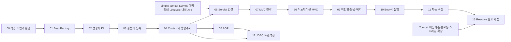

> 이전안: 2026-11-06 전면 재설계 이전 기록이다. 단계 번호는 당시 번호이며 현재 학습 순서로 사용하지 않는다.

# simple-tomcat으로 만드는 Spring 구현 로드맵

작성일: 2026-11-06. **조사에 따른 구현 추천안**이며 상세 구현 계획이나 승인된 설계가 아니다. 이번에는 제품 코드를 구현하지 않았다. 단계 구현 전에는 구체적 파일·API·테스트·소스 추가 확인을 포함한 설계와 계획을 따로 저장한다.

소스 기준: Framework v6.2.1·Boot v3.4.1·Tomcat 10.1.34. 아래 S번호는 [소스 대응표](../reference/03-learning-stage-mapping.md)의 실제 클래스·메서드·링크다. 서버 전제는 [연동 계약](../reference/01-embedded-tomcat-contract.md), 차이와 미확인은 [구현 현황](../reference/02-implementation-status.md)에 둔다.

## 1. 구현 방식 비교

| 방식 | 장점 | 비용·조건 | 평가 |
|---|---|---|---|
| 자체 Core·MVC·Boot식을 만들고 simple-tomcat에 연결 | 생성·호출·수명 전 과정을 직접 관찰, 기존 학습 서버 활용 | Spring API 호환과 구분하고 작은 지원 범위를 정해야 함 | **추천**, 내부 구조 학습 목표에 가장 맞음 |
| 실제 Spring Framework/Boot를 simple-tomcat 위에 실행 | 실제 Framework 동작을 그대로 관찰 | 현재 자체 Servlet 계획과 호환되지 않음. 상당한 Jakarta Servlet 구현이 선행 | 첫 구현 경로로는 비용이 큼 |
| 자체 구현과 실제 Spring+공식 Tomcat 예제를 별도로 실행 | 같은 계약 테스트로 동작을 비교하기 좋음 | 두 런타임을 별도 관리; 실제 Spring을 자체 서버에 붙인 것은 아님 | 추천안의 비교 실험으로 병행 가능 |

이 표는 조사자의 평가다. 사용자가 구현 방식을 선택했다고 기록하지 않는다. 첫 완주 목표는 **자체 IoC·AOP·동기 MVC·최소 Boot식 실행/자동 구성**을 이해하는 것이다. 전체 Spring 호환·운영 제품·전체 생태계 재구현을 목표로 잡지 않는다.

## 2. 패키지와 의존성 제안

| 패키지 | 책임 | 다른 계층에 노출할 개념 |
|---|---|---|
| `minispring.beans` | 빈 정의·조회·생성·의존성 해결·스코프 | BeanDefinition, BeanFactory, BeanPostProcessor |
| `minispring.context` | 설정 등록·refresh·이벤트·종료 | ApplicationContext, 설정 처리기 |
| `minispring.aop` | pointcut·advice·호출 체인·프록시 후처리 | Advisor, MethodInterceptor |
| `minispring.web.servlet` | Servlet 디스패칭과 MVC 전략 | DispatcherServlet, HandlerMapping/Adapter |
| `minispring.web.bind` | 인자·반환값·메시지 변환 | ArgumentResolver, ReturnValueHandler |
| `minispring.boot` | 실행·서버 factory·조건부 기본 구성 | MiniApplication, WebServerFactory |
| `minispring.transaction` | 선택 확장: JDBC 경계·자원 공유 | TransactionManager, 자원 holder |
| `example.order` | 기존 README의 업무 예제 | OrderService·Repository·Controller |

이름은 후보이며 실제 파일명·시그니처는 단계 설계에서 정한다. 예제가 framework에 의존하고 framework는 예제를 참조하지 않는다. core는 HTTP를, Tomcat은 빈·Controller를 몰라야 한다. 자체 어노테이션은 Spring의 것과 다른 패키지에 둔다.

Java 21·Maven Wrapper·JUnit Jupiter를 추천한다. Tomcat과 빌드·JDK를 맞추되 조사 중에는 빌드 파일을 생성하지 않았다. 초기 core는 JDK로 작성하고 JSON 직렬화·DB는 해당 단계에서 라이브러리와 버전을 별도로 결정한다.

## 3. 학습 의존 순서

학습상 AOP를 웹보다 먼저 읽는 순서를 추천한다. MVC 자체는 AOP 없이도 구현할 수 있다. 서버 선행 작업을 기다리는 동안 00~05는 네트워크 없이 진행할 수 있다.

## 4. 단계별 구현과 완료 기준

### 00 — 직접 객체를 조립하고 경계를 확인한다

- **문제·작업:** OrderRepository·InMemoryOrderRepository·OrderService를 직접 생성한다. 생성·연결을 맡는 조립 코드와 업무 로직을 분리한다. 빌드 환경을 이 작업의 일부로 만든다.
- **정상:** 저장소를 가짜 객체로 교체해도 서비스 코드를 수정하지 않고 저장 요청을 관찰한다.
- **경계·완료:** 잘못된 주문 값과 저장소 실패가 업무 계약대로 전파된다. 이 시점에는 컨테이너가 없고 생성자 DI를 수동으로 수행한다는 점을 설명한다.
- **Spring 대조:** 이후 S02~S05가 이 조립 책임을 맡는 지점을 비교한다. 수동 DI 자체를 Spring만의 기능으로 설명하지 않는다.

### 01 — 빈 정의·조회·스코프를 분리한다

- **문제·작업:** 이름을 키로 빈 생성 메타데이터와 완성된 singleton을 분리한다. 우선 명시적인 supplier 등록으로 시작한다. `getBean(name)`과 제한적인 타입 조회를 제공한다.
- **핵심·근거:** S02·S06. singleton의 단위는 JVM의 클래스 하나가 아니라 **컨테이너의 빈 정의/이름**이다. prototype은 조회마다 생성한다.
- **정상:** 같은 이름 두 번 조회는 동일 객체, 다른 컨테이너는 별개, 같은 구현 클래스의 두 정의도 서로 별개다.
- **경계·완료:** 미등록 이름, 타입 후보 0개·해결 불가능한 복수 후보, supplier 예외를 검증한다. 생성 실패 객체를 캐시하지 않고 이후 조회의 생성 상태가 오염되지 않는다. 동시 조회를 지원하는 시점에는 생성 횟수 1회를 검증한다.
- **범위:** parent factory·alias·FactoryBean·사용자 정의 scope는 포함하지 않는다. 지원하지 않는 범위를 Spring 전체와 동일하다고 표현하지 않는다.

### 02 — 생성자 의존성을 재귀적으로 해결한다

- **문제·작업:** supplier의 수동 `getBean` 호출을 줄인다. 공개 생성자 하나를 가진 클래스의 매개변수를 읽고, 유일한 대입 가능 후보를 재귀적으로 주입한다.
- **핵심·근거:** S03~S06. dependency 먼저 생성, 완성된 반환 객체 주입, 생성 중 상태는 finally로 정리, 원인 예외와 주입 지점을 보존한다.
- **정상:** Service → Repository 그래프를 정의 등록만으로 생성한다. 인터페이스에 구현체를 주입한다.
- **경계·완료:** 후보 없음, 구별 조건 없는 동등한 후보 둘, 생성자 예외, `A → B → A` 순환을 검증한다. Spring과 자체 구현의 동등 비교는 이 제한된 입력 집합에서 한다.
- **범위:** 필드·setter 순환 해결은 없다. `@Primary`·qualifier·이름 기반 선택·컬렉션 주입을 지원할 때는 S04의 후보 선택 규칙을 추가 구현한다. Spring이 복수 후보면 무조건 실패한다고 가르치지 않는다.

### 03 — 설정과 스캔을 빈 정의 등록으로 연결한다

- **문제·작업:** 명시 클래스 목록의 component 탐색 → 디렉터리 패키지 스캔 → 설정 메서드 등록 순서로 확장한다. 탐색이 곧 일반 빈 인스턴스 생성이 되지 않도록 한다.
- **핵심·근거:** S07~S09. 발견 결과는 BeanDefinition이다. factory method 매개변수도 컨테이너로 해결한다.
- **정상:** 같은 주문 예제를 프로그램 등록과 component 등록 양쪽으로 실행한다. 설정 메서드의 인자에 관리 빈을 전달한다.
- **경계·완료:** 중복 정의·잘못된 설정 메서드·빈 후보 누락을 시작 단계에서 드러낸다. 후보 탐색만으로 업무 클래스의 static 초기화가 실행되지 않는지 검증한다. JAR 스캔은 지원 범위에 넣을 때 별도 검증한다.
- **중요한 경계:** full `@Configuration`의 메서드 간 호출은 CGLIB로 BeanFactory 조회에 연결된다. 첫 구현은 **Spring의 `proxyBeanMethods=false`에 대응하는 설정만** 제공하는 안을 추천한다. 메서드 간 직접 호출을 singleton 조회로 바꾸지 않으며 full configuration을 지원한다고 이름만 붙이지 않는다. full 지원은 별도 소스 확인·계획이 필요하다.

### 04 — ApplicationContext의 refresh와 생명주기를 구현한다

- **문제·작업:** 정의 후처리와 인스턴스 후처리를 구분하고 refresh·close를 조정한다. 생성자/주입 → 초기화 전 후처리 → init → 초기화 후 후처리 → 최종 singleton 노출을 연결한다.
- **핵심·근거:** S03·S06·S10. 정의 후처리가 일반 빈 생성보다 앞서야 하고 빈 후처리기는 일반 빈 생성 전에 준비되어야 한다. non-lazy singleton의 선행 생성과 prototype 조회 생성을 구분한다.
- **정상:** 이벤트 기록으로 순서를 검증하고, 후처리기가 바꾼 최종 객체를 조회·주입받는다. 지원하는 init/destroy callback은 각 1회다.
- **경계·완료:** 중간 init 실패 때 이미 관리되던 singleton을 정리한다. 생성 완료되지 않은 객체를 정상 초기화 빈으로 등록하지 않는다. dependent를 dependency보다 먼저 파괴하며 반복 close가 중복 destroy를 하지 않는다. prototype 파괴는 컨테이너가 자동 관리하지 않는다.
- **추가 확인:** `@PostConstruct`/`@PreDestroy`를 지원하기 전에는 해당 후처리기와 DisposableBeanAdapter의 세부 순서를 조사한다. 위 개요만으로 모든 callback 순서를 구현하지 않는다.

### 05 — 후처리 시점에 AOP 프록시를 적용한다

- **문제·작업:** 메서드 실행 시간 등 공통 기능을 업무 객체 밖으로 옮긴다. interceptor chain과 JDK 동적 프록시부터 구현하고 BeanPostProcessor에 연결한다.
- **핵심·근거:** S11·S12. 순환이 없는 일반 빈은 초기화 후 프록시가 만들어지고 그 최종 참조를 다른 빈이 받는다.
- **정상:** 외부 인터페이스 호출은 before → target → after 순서, 다중 advice 순서, 반환값 보존을 검증한다.
- **경계·완료:** 대상 예외의 타입과 cause가 reflection 래퍼로 오염되지 않는다. 자기 호출은 advice를 거치지 않는지 비교한다. init 안의 자기 호출도 나중에 만들어질 프록시를 통과한 것으로 기록하지 않는다.
- **범위:** JDK 프록시는 인터페이스 조회·주입을 기준으로 검증한다. 클래스 기반 프록시와 순환 의존의 early proxy는 별도 단계다. Boot의 프록시 기본 설정까지 복제한 것으로 주장하지 않는다.

### 06 — 내장 Tomcat의 Servlet에 연결한다

- **선행:** simple-tomcat의 Servlet·매핑·필터·Lifecycle·내장 API가 실제로 준비되어야 한다. 현재는 준비되지 않았다.
- **문제·작업:** 컨테이너 빈에서 Controller/Service를 가져오는 하나의 DispatcherServlet을 `/`에 등록한다. 먼저 명시적 조립으로 내장 서버를 시작한다.
- **핵심·근거:** S37과 [연동 계약](../reference/01-embedded-tomcat-contract.md). Tomcat은 Servlet 수명을, Spring은 업무 빈 수명을 소유한다. Servlet 매핑과 MVC handler 매핑을 구분한다.
- **정상:** 기동 전에 주문 한 건을 저장하고 실제 TCP의 `/hello`, `/orders/count`가 같은 디스패처를 거쳐 200을 반환한다. 포트 0에서 실제 포트를 얻는다.
- **경계·완료:** init 실패 시 요청을 받지 않음, 업무 예외 후 다음 요청 성공, 중복 종료·포트 반환, 사용 중 Servlet 파괴 방지를 검증한다. 디스패처가 빈으로도 관리될 경우 이중 destroy를 방지한다.
- **범위:** 초기에 문자열 응답을 사용한다. 본문 파싱·URL 디코딩을 직접 소켓 처리로 MVC 안에 넣지 않는다.

### 07 — Dispatcher와 MVC 전략을 분리한다

- **문제·작업:** 경로 Map에서 바로 메서드를 호출하는 실험을 HandlerMapping·HandlerAdapter·HandlerExecutionChain으로 분리한다. 처음에는 명시적으로 handler를 등록한다.
- **핵심·근거:** S13·S17. handler 탐색 → adapter 선택 → interceptor pre → handler → post → 결과 처리 → completion 순서다. 실패·중단 때 호출되는 callback 집합은 다르다.
- **정상:** 서로 다른 handler 형태를 적절한 adapter가 처리한다. interceptor pre는 등록 순서, post/completion은 역순이다.
- **경계·완료:** pre가 false이면 handler·post를 실행하지 않는다. completion은 pre가 true로 끝난 interceptor에만 호출한다. handler 예외, 결과 쓰기 예외, interceptor 예외 후에도 완료 처리가 중복되지 않는다. handler 없음과 adapter 없음은 서로 다른 실패다.
- **범위:** async dispatch는 없다. 동기 REQUEST 안에서 검증한 흐름만 일치한다고 기록한다.

### 08 — 어노테이션 MVC와 컨테이너 빈을 연결한다

- **문제·작업:** Controller·RequestMapping에 해당하는 자체 어노테이션에서 mapping을 추출하고 HandlerMethod를 등록한다. 처음에는 HTTP 메서드와 정확한 경로 조건에 집중한다.
- **핵심·근거:** S14~S16·S20. 등록 시 충돌 검사, 클래스·메서드 조건 결합, 실행 때 관리 빈 조회. Dispatcher가 Controller를 직접 `new` 하지 않는다.
- **정상:** class-level `/orders`와 method-level `/count`의 결합, 같은 Service 주입, GET 요청의 handler 선택을 검증한다.
- **경계·완료:** 동일 조건의 서로 다른 handler는 시작 시 실패한다. 존재하지 않는 경로는 404, 경로는 있지만 메서드 불일치는 405와 Allow를 검증한다. GET 매핑의 HEAD 처리와 OPTIONS 응답도 지원 선언 전에 확인한다.
- **추가 확인:** 정확 매핑 이후 URI template·wildcard·구체성 우선순위·실행 시 동률은 PathPattern/RequestCondition 관련 소스를 추가 확인하고 계획을 보완한다. 정규식 하나로 Spring 전체 매칭을 대체하지 않는다.

### 09 — 바인딩·반환값·예외 처리의 경계를 만든다

- **문제·작업:** argument resolver → 변환 → handler 호출 → return value handler → message converter 또는 View로 분리한다. String/plain text부터 시작하고 JSON **응답**을 추가한다. 예외 resolver와 interceptor를 함께 검증한다.
- **핵심·근거:** S13·S16·S18~S20·S38. 일반 Controller의 문자열 view name과 ResponseBody의 문자열 본문은 다르다. 해결된 예외와 미해결 예외의 전파도 구분한다.
- **정상:** 명시 이름의 query parameter·숫자 변환, ResponseBody의 문자열·JSON 반환, 단순한 View.render 구현을 검증한다. JSON은 converter 계약을 직접 만들고 직렬화 엔진은 별도 라이브러리를 사용할 수 있다.
- **경계·완료:** 필수 인자 누락·변환 오류 400, 응답 표현 불일치 406, 미해결 업무 예외 500·이후 요청 성공, 해결된 예외 뒤 completion에 전달되는 예외 값을 검증한다. View 반환을 응답 본문으로 조용히 바꾸지 않는다.
- **서버 선행:** query parameter는 원문/디코딩·반복 값 계약이 먼저 필요하다. JSON **요청**의 400/415 검증은 서버 본문 지원 이후다. 현재 서버에서는 본문이 있으면 MVC 진입 전 501이므로 JSON 요청 완료로 표시할 수 없다. JSP 엔진은 필요하지 않으며 forward가 필요한 View는 서버 확장 전 제외한다.
- **추가 확인:** Spring의 세부 인자 기본값·빈 문자열 처리·validation·content negotiation 규칙은 각 지원 기능 구현 전 resolver/converter 소스를 추가 확인한다.

### 10 — Boot식 시작과 종료를 구현한다

- **문제·작업:** 앞 단계의 수동 조립을 MiniApplication.run으로 옮긴다. Environment의 명시 값, context factory, WebServerFactory, Servlet 등록, lifecycle을 연결한다. 이 단계에서는 자동 구성을 섞지 않는다.
- **핵심·근거:** S21~S25. refresh의 onRefresh에서 서버를 준비하고 finishRefresh의 lifecycle에서 실제 요청 수락을 시작한다. 실제 Boot는 서버 초기화 중 필요한 일부 빈이 일찍 생성될 수 있으며 모든 빈 생성 뒤에야 서버 객체를 만든다는 설명은 틀리다.
- **정상:** 빈·mapping 준비 전에 업무 요청이 처리되지 않는다. 시작 완료 뒤 실제 포트로 주문 조회가 성공한다. 임시 포트와 명시 포트 양쪽을 검증한다.
- **경계·완료:** factory 없음·둘 이상, 빈 init 실패, 포트 충돌 시 시작 실패가 호출자에게 전파되고 빈·Servlet·스레드·포트가 정리된다. 종료 시 활성 요청이 쓰는 빈을 먼저 파괴하지 않는다.
- **서버 계약 변경점:** 현재 Endpoint는 생성자에서 바인딩한다. 실제 Boot Tomcat 경로는 초기 바인딩을 지연한다. 이를 같다고 처리하지 말고 Tomcat 쪽 준비/바인딩/수락 분리 계획을 먼저 확정한다.
- **배포:** 고정한 simple-tomcat JAR과 앱 JAR을 별도 classpath/배포 lib로 연결하는 방식부터 검증한다. Boot loader·nested JAR를 구현할 필요는 없다. executable JAR 포장은 별도 완료 조건으로 정한다.

### 11 — 조건부 자동 구성과 사용자 설정 우선권을 구현한다

- **문제·작업:** 명시 설정으로 동작하던 서버 factory·MVC 전략을 기본 구성으로 제공한다. 사용자 정의 등록 → 자동 구성 후보 로딩 → 조건 평가 → 기본 정의 등록 → 빈 생성 순서를 만든다.
- **핵심·근거:** S26·S27. classpath/property/bean 조건과 back-off가 핵심이다. 조건 검사를 위해 업무 빈을 먼저 생성하지 않는다. 후보 파일은 `.imports` 방식에 대응하는 자체 리소스를 제안한다.
- **정상:** 기본 factory를 사용한 실행과 사용자 factory를 등록한 실행에서 후자는 사용자가 제공한 객체를 사용한다. 선택 이유를 조건 보고서로 볼 수 있다.
- **경계·완료:** 사용자 빈이 아직 인스턴스화되지 않아도 기본값이 등록되지 않는다. property 불일치·필요 클래스 부재·사용자 빈 존재에서 각각 기본 구성이 빠진다. 자동 구성끼리의 순서가 bean 조건 결과에 영향을 주는 사례를 검증한다.
- **추가 확인:** property source 전체 우선순위·relaxed binding·auto-configuration 정렬 알고리즘은 미확인이다. 처음에는 명시한 설정 입력만 지원하고, 전체 Boot 설정과 같다고 선언하기 전에 소스를 더 조사한다. starter/BOM은 runtime 조건과 별도다.

### 12 — 선택 확장: AOP로 JDBC 트랜잭션을 적용한다

- **선행:** 05의 프록시. HTTP 없이 구현할 수 있고 `simple-jorm` 연결은 별도 통합 작업이다.
- **문제·작업:** 수동 JDBC 경계 → TransactionManager → interceptor → 어노테이션 순서로 확장한다. 먼저 동기 REQUIRED와 단일 DataSource를 다룬다.
- **핵심·근거:** S28~S32. 최외곽에서 연결을 열고 같은 thread·DataSource에 바인딩한다. Repository는 같은 연결을 재사용하고 트랜잭션 중 임의 close하지 않는다. 참여자는 독립 commit하지 않는다.
- **정상:** 두 Repository의 연결 정체성 일치, 최외곽 commit 한 번, 별도 트랜잭션은 별도 자원 수명을 검증한다.
- **경계·완료:** 기본 설정에서 RuntimeException/Error는 rollback, checked exception은 commit이다. 내부 REQUIRED 실패를 외부가 잡아도 rollback-only가 남아 최종 완료 시 UnexpectedRollback에 해당하는 실패가 난다. 예외·commit 실패 후 thread-bound 연결 제거와 설정 복원을 검증한다. 자기 호출은 별도 proxy 경계가 생기지 않는다.
- **범위:** REQUIRES_NEW·NESTED·JTA·reactive transaction·모든 synchronization callback은 별도 조사 대상이다. ThreadLocal만 쓰고 rollback-only·소유권을 생략한 구현을 REQUIRED 완성으로 기록하지 않는다.

### 13 — 선택 확장: Reactive/WebFlux 학습 과정을 분리한다

- **선행:** 별도 설계로 Tomcat에 async request 수명·논블로킹 read/write·streaming·cancel/error/timeout 처리를 구현해야 한다. 기존 7단계 계획을 완료해도 이 조건은 자동으로 갖춰지지 않는다.
- **문제·작업:** 먼저 네트워크 없는 Publisher/Subscriber 수요·완료·취소 실험을 한다. 이후 HttpHandler → exchange/filter chain → DispatcherHandler → mapping/adapter/result handler로 연결한다.
- **핵심·근거:** S33~S36. service 반환과 응답 완료가 분리되며 수요·쓰기 가능 상태에 맞춰 전송한다. 단순 Future·가상 스레드·Mono 반환형 추가만으로 이 계약을 대체할 수 없다.
- **정상:** 늦게 완료되는 응답, 느린 소비자의 제한된 demand, 스트리밍 순서가 관찰된다.
- **경계·완료:** service 반환 후 연결을 닫지 않음, 수요보다 많이 보내지 않음, 클라이언트 취소·중간 오류·timeout·shutdown 때 subscription과 버퍼·연결 정리를 검증한다.
- **미확인:** Reactive Streams 상세 규칙, Reactor operator 구현, listener readiness 경합·버퍼 소유권, reactive transaction은 아직 조사되지 않았다. 이번 로드맵만으로 구현에 들어갈 수 없다. 실제 Reactor를 사용해 웹 계층에 집중할지부터 별도 결정한다.

## 5. 단계마다 반복할 작업 방식

1. 이전 단계의 어떤 수동 책임을 옮길지 한 문장으로 정한다.
2. 고정 태그의 해당 메서드와 실패 분기를 추가 확인한다.
3. 단계 설계·상세 구현 계획에 지원 입력, 핵심, 차이, 테스트를 저장한다.
4. 정상·경계·실패 계약 테스트를 먼저 실행하고 최소 기능을 구현한다.
5. 해당 단계의 단위 검증과 필요한 실제 HTTP/DB 검증을 수행한다. 서버가 필요한 단계는 mock 검증만으로 완료하지 않는다.
6. 단계 설명·진행 상황·구현 현황·소스 대응표·목차와 작업 계획에 실제 결과를 반영한다.

## 6. 첫 완주의 판정

11단계까지의 제한된 지원 범위에서 사용자가 서버 내부를 수정하지 않고 앱을 실행하고, 컨테이너가 만든 Controller→Service→Repository로 요청이 전달되며, 설정을 바꾸면 자동 구성 기본값이 물러나야 한다. 시작 실패·요청 실패·종료 실패의 책임 위치를 설명하고 검증할 수 있어야 한다.

12·13단계는 별도 완주 목표다. Security·Spring Data·Cloud·Batch·AOT·전체 Servlet 구현을 필수 조건에 섞지 않는다. 현재 어느 단계도 구현 완료로 표시하지 않는다.
